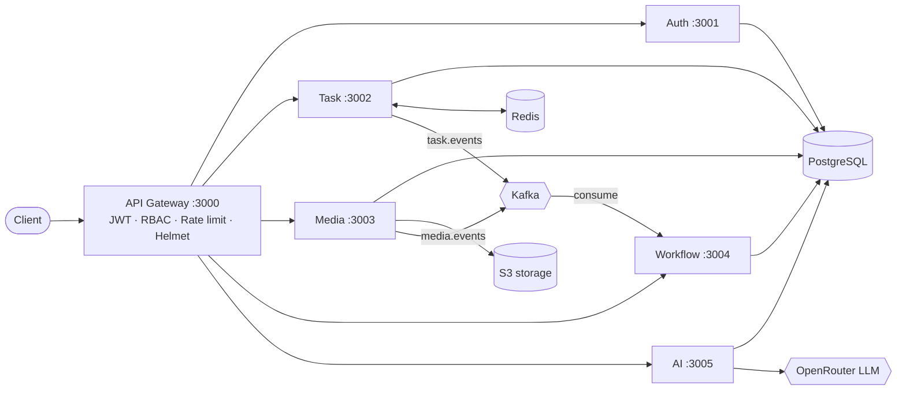
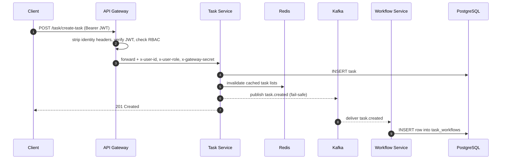

<div align="center">

# 🧩 TaskFlow: Event-Driven Microservices Backend

**Six Node.js + TypeScript services, one secure gateway, Kafka-powered workflows, and an AI that summarizes your tasks.**


</div>

---

## Overview

TaskFlow is a task-management backend built the way real distributed systems are: **clients only talk to one gateway, internal services never trust the outside world, and services communicate through events instead of tight coupling.**

| What it demonstrates | How |
|---|---|
| **Microservice architecture** | 6 independent services plus a shared workspace package |
| **Zero-trust internal network** | Gateway-only ingress, header stripping, shared-secret verification |
| **Event-driven design** | Kafka producers and consumers build a per-task audit timeline |
| **Performance** | Redis cache-aside with invalidation and hit/miss counters |
| **AI integration** | An LLM reads real task + timeline data and writes summaries |
| **DevOps basics** | Docker, Docker Compose, GitHub Actions CI |

---

## Architecture



### Services

| Service | Port | Responsibility |
|---|---|---|
| **API Gateway** | 3000 | Single entry point: JWT verification, RBAC, rate limiting, reverse proxy |
| **Auth Service** | 3001 | Register, login (bcrypt + JWT), current user |
| **Task Service** | 3002 | Task CRUD, ownership checks, Redis caching, publishes `task.created` |
| **Media Service** | 3003 | Image uploads to S3-compatible storage, publishes `attachment.uploaded` |
| **Workflow Service** | 3004 | Kafka consumer that records every event into a per-task timeline |
| **AI Service** | 3005 | Reads a task and its timeline, generates and stores an LLM summary |

### Life of a request: `POST /task/create-task`



The client gets its response **before** the timeline is written. The workflow service catches up asynchronously, so a slow or failing consumer never slows down task creation.

### How the AI summary works

```
POST /ai/tasks/:taskId/summary
   1. check the user owns the task (or is ADMIN)
   2. load the task and its Kafka-built timeline from PostgreSQL
   3. send both to the LLM with a strict "don't invent facts" prompt
   4. store the result in ai_summaries and return it
```

---

## Security model

| Layer | Protection |
|---|---|
| **Network** | Only the gateway port is exposed; internal services are unreachable from outside |
| **Identity spoofing** | Gateway deletes any client-sent `x-user-id`, `x-user-role` and `x-gateway-secret` first |
| **Service trust** | Every service rejects requests without the correct `x-gateway-secret` (403) |
| **Authentication** | JWT verified at the gateway, payload shape validated |
| **Authorization** | Method + path RBAC at the gateway, ownership checks again inside services |
| **Abuse protection** | Rate limiting, `helmet` headers, 10 MB image-only upload filter |
| **Passwords** | Hashed with bcrypt |
| **Input** | Zod schemas validate every request body |
| **Secrets** | `.env` excluded from git and Docker images |

---

## Engineering highlights

- **Fail-safe event publishing.** `publishJsonSafe` catches broker errors and logs them, so Kafka downtime never breaks the user-facing write path.
- **Cache-aside with invalidation.** Task reads use Redis (TTL 60s). Create, update and delete invalidate the task key and both user and admin list keys. Hits and misses are counted in Redis (`cache:hits`, `cache:misses`), so the hit ratio is measurable.
- **One shared package.** Logger, errors, JWT helpers, DB pool, Redis, Kafka producer/consumer and validation live in `packages/shared`, used by every service as a workspace package.
- **Consistent layering.** Every service follows `route → controller → service → repository`.
- **AI grounded in real data.** The summary comes from the actual timeline stored in the database, not from guesswork.
- **Uniform API contract.** Success is `{ success: true, data }`, errors are `{ success: false, message }`, handled by one global error handler.
- **Structured logging.** Pino JSON logs with per-request logging via pino-http.

---

## Problems I ran into (and how I fixed them)

| Problem | Root cause | Fix |
|---|---|---|
| Task timeline was always empty | Kafka consumer crashed with *"group coordinator is not available"*; the client had `retries: 0`, so it never recovered | Enabled client and consumer retries so services self-heal while Kafka finishes starting |
| Old tasks never got timeline events | Consumer reads from the latest offset, so events published while it was down were skipped | Understood the `fromBeginning` trade-off and tested with fresh events |
| Gateway returned `504` | Target service wasn't running; the proxy failed to connect | Traced a 24 ms failure in gateway logs to the missing service |
| Services couldn't find each other in Docker | `localhost` inside a container is the container itself | Used service names (`kafka:9092`, `postgres:5432`, `auth-service:3001`) |
| Kafka unreachable from other containers | Default advertised listener is `localhost` | Configured single-node KRaft Kafka with `KAFKA_ADVERTISED_LISTENERS=PLAINTEXT://kafka:9092` |

---

## Tech stack

| Area | Technology |
|---|---|
| Runtime / Language | Node.js 24, TypeScript |
| Framework | Express 5 |
| Data | PostgreSQL (`pg`), Redis (`ioredis`) |
| Messaging | Apache Kafka (`kafkajs`, KRaft, no ZooKeeper) |
| Auth | JWT, bcryptjs |
| Validation | Zod |
| Storage | S3-compatible (`@aws-sdk/client-s3`), Multer |
| AI | OpenRouter (OpenAI-compatible API) |
| Gateway | http-proxy-middleware, helmet, cors, express-rate-limit |
| Logging | Pino, pino-http |
| DevOps | Docker, Docker Compose, GitHub Actions |
| Monorepo | npm workspaces |

---

## Project structure

```
.
├── apps/
│   ├── api-gateway/       # JWT, RBAC, rate limiting, reverse proxy
│   ├── auth-service/      # register, login, get-me
│   ├── task-service/      # task CRUD, Redis cache, Kafka producer
│   ├── media-service/     # image upload, S3 storage, Kafka producer
│   ├── workflow-service/  # Kafka consumer, per-task event timeline
│   └── ai-service/        # LLM task summaries
├── packages/
│   └── shared/            # logger, errors, JWT, DB, Redis, Kafka, validation
├── sql/                   # ordered SQL migrations
├── scripts/db-migrate.ts  # migration runner
├── Dockerfile
├── docker-compose.yml
└── .github/workflows/ci.yml
```

---

## API reference

All routes go through the gateway at `http://localhost:3000`. Protected routes need `Authorization: Bearer <token>`.

| Method | Endpoint | Access | Description |
|---|---|---|---|
| POST | `/auth/register` | Public | Create an account |
| POST | `/auth/login` | Public | Log in, returns a JWT |
| GET | `/auth/get-me` | User, Admin | Current user |
| POST | `/task/create-task` | User, Admin | Create a task |
| GET | `/task/list-task` | User, Admin | List tasks (admins see all) |
| GET | `/task/:id` | User, Admin | Get one task |
| PUT | `/task/:id` | User, Admin | Update a task |
| DELETE | `/task/:id` | Admin | Delete a task |
| POST | `/tasks/:taskId/attachments` | User, Admin | Upload an image (form-data field `image`) |
| GET | `/tasks/:taskId/attachments` | User, Admin | List attachments |
| GET | `/task-workflow/:taskId/workflows` | User, Admin | Task event timeline |
| POST | `/ai/tasks/:taskId/summary` | User, Admin | Generate an AI summary |
| GET | `/ai/tasks/:taskId/summaries` | User, Admin | Past summaries |

**Example: AI summary response**

```json
{
  "success": true,
  "data": {
    "summary": {
      "id": "fac5da33-34e9-4296-a848-aaf53455d7b6",
      "taskId": "dccdda4e-da11-4c65-b2f2-baba59280857",
      "output": "The task \"Learn distributed systems in Golang\" is currently open. So far, the only logged event is the task's creation, with no further progress documented.",
      "model": "openrouter/free",
      "createdAt": "2026-11-14T18:11:14.983Z"
    }
  }
}
```

---

## Getting started

Create a `.env` in the project root (variables below), then:

```bash
docker compose up --build
```

Run the database migration once to create the tables:

```bash
npm run db:migrate
```

The API is now available at `http://localhost:3000`.

<details>
<summary><b>Run without Docker</b></summary>

<br>

Start PostgreSQL, Redis and Kafka locally, point the URLs in `.env` to `localhost`, then run each service in its own terminal:

```bash
npm install
npm run db:migrate
npm run dev:gateway
npm run dev:auth
npm run dev:task
npm run dev:media
npm run dev:workflow
npm run dev:ai
```

</details>

<details>
<summary><b>Environment variables</b></summary>

<br>

| Variable | Purpose |
|---|---|
| `DATABASE_URL` | PostgreSQL connection string |
| `REDIS_URL` | Redis URL |
| `KAFKA_BROKERS` | Kafka broker list |
| `PORT`, `AUTH_PORT`, `TASK_PORT`, `MEDIA_PORT`, `WORKFLOW_PORT`, `AI_PORT` | Service ports |
| `AUTH_SERVICE_URL`, `TASK_SERVICE_URL`, `MEDIA_SERVICE_URL`, `WORKFLOW_SERVICE_URL`, `AI_SERVICE_URL` | Where the gateway forwards requests |
| `JWT_SECRET`, `JWT_EXPIRES_IN` | Token signing and lifetime |
| `GATEWAY_SECRET` | Shared secret between gateway and services |
| `OPENROUTER_API_KEY`, `AI_MODEL` | LLM access |
| `AWS_ENDPOINT_URL_S3`, `AWS_ACCESS_KEY_ID`, `AWS_SECRET_ACCESS_KEY`, `AWS_REGION`, `STORAGE_BUCKET` | File storage |

`.env` is git-ignored and docker-ignored. Never commit it.

</details>

---

## CI pipeline

`.github/workflows/ci.yml` runs on every push to `main` and on every pull request:

```
push ─► typecheck (tsc --noEmit, all services)
              │ pass
              ▼
        docker-build (matrix: one parallel job per service)
              │
              ▼
          ✅ green / ❌ red
```

A type error or a broken Dockerfile fails the pipeline before the change is trusted.

---

## Design decisions and trade-offs

- **Shared database for now.** One PostgreSQL instance keeps the project easy to run. The cost is data-layer coupling (the AI and workflow services read the `tasks` table directly). The next step is per-service ownership.
- **Docker Compose, not Kubernetes.** Six small services on one host don't need an orchestrator.
- **Gateway RBAC plus service-level ownership checks.** Coarse rules at the edge, fine-grained data rules where the data lives.
- **At-most-once event delivery.** Publishing is fail-safe, favoring availability over guaranteed delivery. A transactional outbox would be the upgrade path.

---

## Roadmap

**Shipped**

- [x] API gateway with JWT auth, RBAC and rate limiting
- [x] Event-driven task timeline (Kafka producers + workflow consumer)
- [x] Redis cache-aside with invalidation
- [x] AI task summaries grounded in the event timeline
- [x] Dockerized services and GitHub Actions CI (type-check + image builds)

**Next: quality and developer experience**

- [ ] OpenAPI / Swagger docs served by the gateway at `/docs`
- [ ] Unit tests (RBAC path matching, services) and integration tests against real Postgres/Kafka containers, running in CI
- [ ] Correlation IDs propagated from the gateway through every service's logs
- [ ] Graceful shutdown (drain requests, disconnect Kafka and DB cleanly)

**Reliability**

- [ ] Transactional outbox so events are never lost between a DB write and a Kafka publish
- [ ] Idempotent consumers and a dead-letter topic for failed events
- [ ] Retry with backoff and a timeout budget for LLM calls
- [ ] Cache AI summaries in Redis to avoid repeat LLM calls
- [ ] Docker healthchecks and an aggregated `/health` endpoint

**Observability**

- [ ] Prometheus metrics (request latency, cache hit ratio, consumer lag) with a Grafana dashboard
- [ ] Centralized log shipping

**Deployment**

- [ ] Continuous deployment to a cloud VM with HTTPS (Caddy or Nginx)
- [ ] Proper secrets management instead of a plain `.env`

**Product features**

- [ ] Task status workflow (`OPEN → IN_PROGRESS → RESOLVED → CLOSED`) with an event per transition
- [ ] Event-driven AI: a Kafka consumer that refreshes summaries when new events arrive
- [ ] AI auto-tagging and priority suggestions
- [ ] Refresh tokens and logout
- [ ] Attachment delete endpoint

---

<div align="center">

**Built by [Ali Sorathiya](https://github.com/ali-sorathiya64)**

</div>